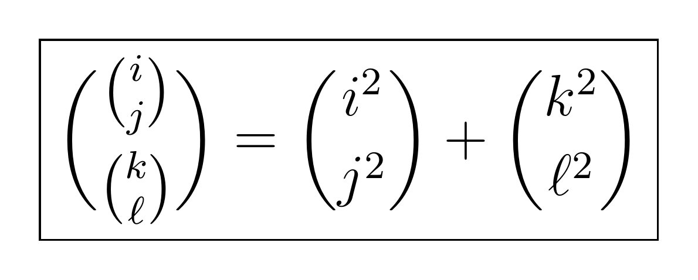

# 入れ子の二項係数方程式：v1〜v8

2026年11月5日公開。問題提案者とChatGPTによる研究記録です。

右辺は上下の添字を二乗した二項係数です。通常の二項係数が定義される非負整数を対象とします。

**全解の分類は未完了で、具体的な解も未発見です。** 部分的な排除証明、必要条件、再現コード、有限証明書を公開しています。外部研究者の査読を受けた論文ではありません。

## コードをGitHubで読む

**[コード・証明・検証記録の一覧](research/)** ／ **[再現手順](REPRODUCING.md)**

v1〜v8のPython 42本、C++ 4本、Cの補助コード1本、Leanソース4本をファイル一覧から直接閲覧できます。証明ノート、実行ログ、小さい証明書とv8の全2,903件の証明書も配置しました。

- [v8の証明書生成・独立検証コード](research/v8_shifted_prime_power_completion_checks.py)
- [v8の独立再構成・監査コード](research/v8_composite_shifted_completion_audit.py)
- [v8のLeanソース](research/v8_formal/CubeCertificates.lean) ／ [Leanの再現手順と検証範囲](research/v8_formal/README.md)
- Leanの前段階：[v4](research/v4_formal/) ／ [v5](research/v5_formal/) ／ [v6](research/v6_formal/)
- [v8日本語概要](research/PROGRESS_v8_ja.md) ／ [v1〜v7の総合案内](research/README.md)
- [公開ソースの一覧・SHA-256](SOURCE_MANIFEST.json)

大きい生成済み証明書16ファイルは、引き続き下記の完全版Release ZIPに収録しています。公開コードから再生成もできます。既存の数式画像と証明内容は保持しています。

## 最新のv8追加資料

**[v8追加ZIP（約149 KB）](https://github.com/corcondor/nested-binomial-equation/releases/download/v8/nested_binomial_v8_addendum.zip)** ／ [v8公開リリース](https://github.com/corcondor/nested-binomial-equation/releases/tag/v8)

v8の新規27資料（証明・2,903件の全証明書・再現コード・Leanソースと実行ログ・日本語概要）を収録しています。下記のv1〜v7完全版と併用してください。全2,903件の有限算術を公開前に再確認し、GitHubへのアップロード後のハッシュ一致も確認しました。

v8はell=1、j=i−3、i=P^a+2の全素数・全指数の排除などを記録します。Leanで確認されたのは有限算術と明記された補題で、解析・付値による有限還元全体の形式化は未完了です。

## v1〜v7完全版をダウンロード

**[完全版ZIP（約30.3 MB）](https://github.com/corcondor/nested-binomial-equation/releases/download/v1-v7/nested_binomial_v1_v7_complete.zip)**

[公開リリースと検証ハッシュ](https://github.com/corcondor/nested-binomial-equation/releases/tag/v1-v7)

185エントリー。v1〜v7の本文・コード・検証記録に加え、大きい生成済み証明書16件をすべて収録しています。全証明書を揃える場合は、このRelease添付ZIPを利用してください。リポジトリのmainにはコード・証明・検証記録を配置していますが、大きい生成済み証明書16件は含みません。GitHubが各Releaseから自動生成する「Source code」ZIPはタグ時点の内容で、完全版ZIPとは異なります。

SHA-256：
`a02415e5e96525f3f35cbf5855e1385ccc02bacc7cf49c1a23036ae8be4201d0`

## 展開後の読み方

ZIP内のREADME.mdから各版に進めます。

- v1：research/README_ja.md
- v2：research/CONTINUATION_ja.md
- v3：research/PROGRESS_v3_ja.md
- v4：research/PROGRESS_v4_ja.md
- v5：research/PROGRESS_v5_ja.md
- v6：research/PROGRESS_v6_ja.md
- v7：research/PROGRESS_v7_ja.md

v1・v2は初期資料の内容による案内名です。7つの独立したGitタグや各時点の全ファイルのスナップショットが揃っているという意味ではありません。前段階の資料と後続の追加成果をまとめた累積版です。

## 検証の範囲

- 旧配布物169ファイルとv7の15新規資料のハッシュ、ZIP整合性を検証しています。
- 完全ZIP内のRELEASE_MANIFEST.jsonに全配布ファイルのハッシュを収録しています。
- 数学的証明、厳密整数演算による有限証明書、独立したAIによる点検を区別しています。
- Lean実行済みのソースとログはresearch/v4_formal、v5_formal、v6_formalにあります。問題全体やすべての部分結果が形式化済みではなく、v7の新しい定理全体は未形式化です。
- v7の一部は引用したThomas–Mignotteの既知定理に依存します。

各主張の仮定、残る範囲、再計算方法は各版のノートを参照してください。
